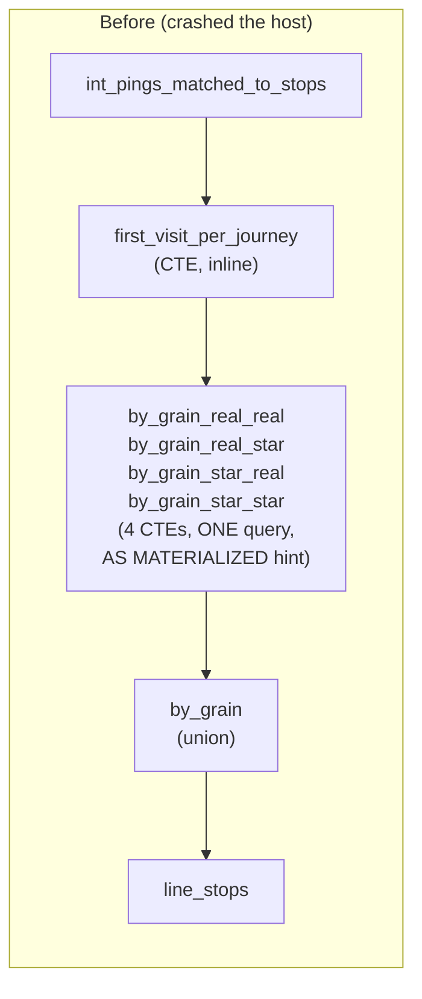
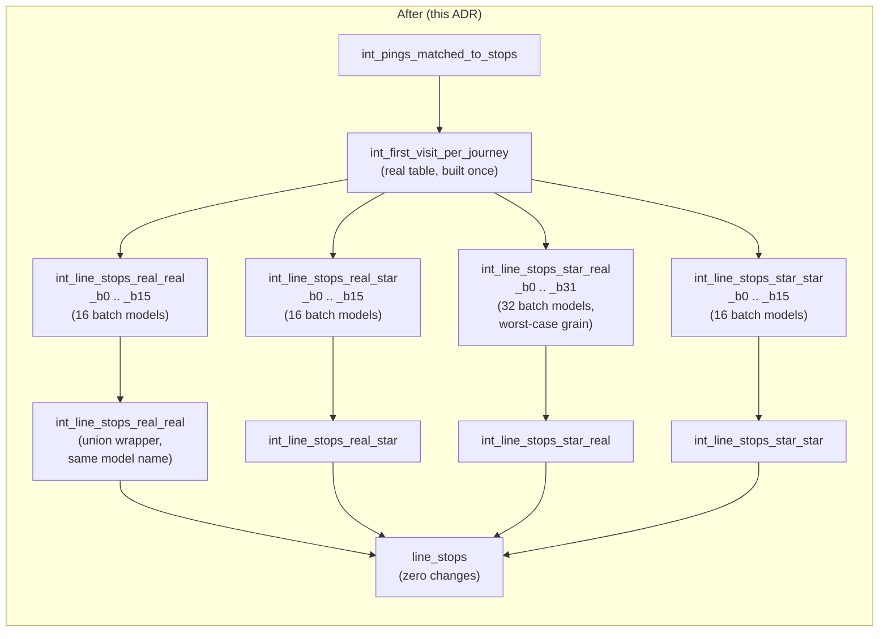

# ADR 0001: line_stops memory architecture — root cause, batching, serial execution

**Status:** **Superseded by [ADR-0008](0008-published-timetables-vs-inferred-routes.md) on 2026-09-21** (the models this ADR governs were deleted). Was: Accepted (extended by [ADR-0002](0002-line-stops-final-assembly.md) — `line_stops`' own final assembly step needed a related but separate fix)
**Date:** 2026-09-15
**Related:** [docs/ROADMAP.md § 1.1.1](../ROADMAP.md), tickets TJP-14092 / TJP-14094

## Context

`line_stops` repeatedly took the whole NAS down — not DuckDB's own graceful
"failed to pin block" error, a real host-level OOM kill needing a physical
reboot. It happened at least three times across two tickets before this ADR's
fix, with `memory_limit` raised reactively each time (3GB → 6GB → 9GB) without
ever addressing why the model needed that much in the first place.

This document records what was actually wrong, every fix attempted (including
the ones that didn't work and why), the real measured numbers behind the final
design, and the decisions made — so the next person touching this model
doesn't have to re-derive any of it, and doesn't accidentally undo a fix whose
reasoning isn't obvious from the diff alone.

## Decision summary

1. Split `line_stops`' four operator/day_type grains into four separate dbt
   models — not CTEs in one query — each independently materialized.
2. Within each grain, further split by `line` into per-batch models (16–32
   batches per grain, 80 total) — group count, not row volume, was the actual
   memory driver.
3. Batch files are **generated**, not hand-typed, from one template +
   config (`dbt/scripts/generate_line_stops_batches.py`).
4. `build.sh` runs this whole cluster (86 models) as a separate `dbt run`
   invocation at `--threads 1` — a hard scheduling guarantee, not an
   optimizer's discretion.
5. Every container in `docker-compose.yml` now has a real `mem_limit` /
   `memswap_limit`, and every manual diagnostic query in this investigation
   was run under an OS-level `systemd-run` memory cap — a runaway process
   gets killed on its own, not the host.
6. Serial execution (`--threads 1`) was chosen over parallel for this
   cluster, based on a measured comparison, not a guess — see
   [Serial vs. parallel](#serial-vs-parallel-full-80-batch-cluster) below.

## Architecture: before → after





`line_stops.sql` never changes across this whole redesign — every grain
model keeps its original name, so its only `ref()`s are unaffected. All 86
models in the shaded cluster run in one `dbt run --threads 1` invocation;
everything else in the project keeps the normal `threads: 3`.

## Investigation timeline

| # | Attempt | Result |
|---|---|---|
| 1 | Raise `memory_limit` (3GB → 6GB → 9GB) reactively | Bought time, never fixed the cause — grows every day as `operator` cardinality grows |
| 2 | Diagnose: 4 CTEs unioning raw rows before one exact `median()` | Root cause found — unbounded per-group memory, 4 grains' state open concurrently |
| 3 | Fix: 4 `AS MATERIALIZED` CTEs in one query, betting DuckDB serializes them | **Unverified assumption, abandoned** — `MATERIALIZED` is a hint, not a barrier; DuckDB's engine can still run independent branches concurrently |
| 4 | Fix: split into 4 separate dbt models, `--threads 1` | Concurrency genuinely fixed — but `int_line_stops_real_real` alone still OOM'd at 2.2GB, no concurrency involved |
| 5 | Fix: `count(distinct journey_key)` → `count(*)` (provably identical, see [below](#decision-2-count-not-countdistinct-journey_key)) | Real inefficiency removed, but **still OOM'd** at 4GB and 6GB |
| 6 | Retest with `memory_limit` *properly* applied to the connection (earlier tests had a methodology bug — see below) | **Confirmed real DuckDB limitation**, not a config mistake: still SIGKILL'd past its own configured limit, no graceful error |
| 7 | Fix: batch each grain by `line` (this ADR's core decision) | Every pilot batch completed cleanly, real margin to spare |

### A methodology bug worth naming

Three of the memory-escalation tests (2.2GB → 4.4GB → 6.6GB OS caps) were run
through a raw `duckdb.connect()` that never applied `profiles.yml`'s
`memory_limit` setting at all — only the external OS cap was ever
constraining anything. The retest that mattered was done properly:
`memory_limit='4GB'` passed directly to the connection config, OS cap at
5GB to give DuckDB room to react gracefully on its own. It still got
SIGKILL'd at 41% scan progress, well past its configured ceiling, with no
DuckDB-level error at any point — unlike the *old* `median()` version,
which threw a clean `"Out of Memory Error: failed to pin block..."` at its
own limit. That contrast is the real evidence: `approx_quantile`'s
per-group t-digest state appears to sit outside DuckDB's spill-managed
memory pool for this aggregate shape. **No `memory_limit` value reliably
bounds it** — this is why batching by `line`, not a bigger number, is the
actual fix.

## Measured data

### Grain cardinality (2026-09-15)

| grain | input rows | distinct groups | distinct lines | worst single line |
|---|---:|---:|---:|---|
| `real_real` | 2,372,412 | 732,266 | 1,507 | `'1'` — 11,349 (1.55%) |
| `real_star` | 2,372,412 | 542,133 | 1,507 | `'1'` — 8,245 (1.52%) |
| `star_real` | 7,862,004 | **1,318,657** | 2,004 | `'1'` — 17,621 (1.34%) |
| `star_star` | 7,862,004 | 798,774 | 2,004 | `'1'` — 9,972 (1.25%) |

`star_real` — not `real_real` — is the worst grain: dropping the operator
filter pulls in all 7.86M rows instead of the 2.37M operator-tagged subset,
and that dominates over having one fewer grouping column. No line ever
exceeds ~1.55% of its grain's total groups — long, evenly-spread tail, no
`'88'`-style dominant outlier.

### Memory-limit escalation (all failed, pre-batching)

| cap tried | config | result | peak RSS measured |
|---|---|---|---|
| 2.2GB | `memory_limit` not applied (raw connection) | SIGKILL | — |
| 4.4GB | `memory_limit` not applied (raw connection) | SIGKILL | 4.28 GiB, still climbing |
| 6.6GB | `memory_limit` not applied (raw connection) | SIGKILL at 17% progress | 6.42 GiB, still climbing |
| 5GB | `memory_limit='4GB'` **properly applied** | SIGKILL at 41% progress | ~4.8–5GB, no graceful error |

```
Peak RSS vs. cap, unbatched real_real (732,266 groups) — none converged
6.6GB cap  ██████████████████████████████████████████████  6.42 GiB (killed, 17%)
5.0GB cap  ████████████████████████████████████████         ~5.0 GiB (killed, 41%, memory_limit=4GB honored on paper, not in practice)
4.4GB cap  ██████████████████████████████████                4.28 GiB (killed)
2.2GB cap  ████████████████████                               killed, no measurement captured
```

### Per-batch pilot measurements (post-batching, solo)

| batch | groups out | agg. time | peak RSS | % of 2.2GB budget |
|---|---:|---:|---:|---:|
| `real_real_b0` | 50,434 | 0.43s | 142,592 KB (139 MiB) | 6.3% |
| `real_star_b0` | 37,108 | 0.43s | 138,880 KB (136 MiB) | 6.2% |
| `star_real_b0`\* | 60,422 | 1.07s | **602,496 KB (588 MiB)** | 26.7% |
| `star_star_b0` | 53,234 | 0.66s | 131,328 KB (128 MiB) | 5.9% |

\* `star_real_b0` carries this grain's single heaviest line (`'1'`,
17,621 groups) — deliberately the worst pilot case. A same-query rerun
later measured only 131 MiB (page-cache warmed by then) — a ~4.5x swing on
identical input. **Treat the cold 588 MiB figure as the trustworthy number**
for capacity planning, not the warm one.

```
Per-batch peak RSS (cold), all comfortably under the 2.2GB budget
star_real_b0  ████████████████████████████████████████████████  588 MiB  (26.7%)
real_real_b0  ████████████                                       139 MiB  (6.3%)
real_star_b0  ████████████                                       136 MiB  (6.2%)
star_star_b0  ███████████                                        128 MiB  (5.9%)
```

### Serial vs. parallel (full 80-batch cluster)

| | serial (1 worker) | parallel (4 workers) |
|---|---:|---:|
| Wall clock | 72.13s | 20.13s |
| Per-query time (median) | 0.85s | 0.88s |
| Baseline memory | 8,048 MB | 8,114 MB |
| **Peak memory** | **8,681 MB** | **9,919 MB** |
| **Peak delta** | **~633 MB** | **~1,805 MB** |
| Result | 80/80 ok | 80/80 ok |

```
Wall clock                          Peak memory delta
serial    ████████████████████ 72s  serial    ██████████████       633 MB
parallel  █████ 20s                 parallel  ████████████████████ 1,805 MB
```

Per-query cost is nearly identical either way (0.85s vs 0.88s median) —
concurrency doesn't corrupt or slow individual queries, it purely stacks
memory pressure by overlapping them. **~3.6x faster for ~2.85x more peak
memory.** Given only one of these two passes has been run cold (see the
cache-warming caveat above), and this is an unattended 3am job with no one
watching it fail, the 52 seconds saved by parallelizing was judged not
worth the added memory exposure — see [Decision 9](#decision-9-serial-threads-1-over-parallel).

## Decisions in detail

### Decision 1: four separate dbt models, not CTEs

Splitting `line_stops`' `by_grain_*` CTEs into four real dbt models
(`materialized='table'`) instead of four CTEs in one query is what actually
guarantees serialization. dbt executes each model as its own
`CREATE TABLE AS` — a real statement, its own transaction — and a
downstream node can't start until its `ref()`'d upstream has finished. A
SQL hint inside one query (`AS MATERIALIZED`, attempted first) cannot make
that guarantee; DuckDB's vectorized, multi-threaded engine is free to run
independent branches concurrently regardless of the hint.

### Decision 2: `count(*)`, not `count(distinct journey_key)`

`int_first_visit_per_journey`'s own `GROUP BY (journey_key, operator, line,
direction, day_type, atco_code)` already guarantees `journey_key` cannot
repeat within any of `line_stops`' grains, which each group by a *subset* of
those columns. `count(distinct journey_key)` and `count(*)` are therefore
provably identical here, always — not an approximation. `DISTINCT` inside an
aggregate forces a per-group hash set to dedupe, the same unbounded-per-group
memory shape as the exact `median()` this whole restructure exists to avoid.
Removing it was a real fix, just not, on its own, a sufficient one (see the
[investigation timeline](#investigation-timeline)).

### Decision 3: batch by `line`, not by anything else

`line` is part of every grain's `GROUP BY` key. Partitioning strictly on
`line` guarantees any two rows sharing a full group key always land in the
same batch — each batch's aggregate is already final and correct for the
groups it contains, no cross-batch merge step needed. This is what makes
batching correctness-safe rather than just a memory workaround: it changes
*how* the answer is computed, never *what* the answer is.

### Decision 4: generated files, not hand-typed

80 near-identical files were never going to be maintained safely by hand —
the whole point of a dbt contract on each grain (catching column drift
between the four grains) doesn't scale to 80 files' worth of hand-copied
`WHERE`/`GROUP BY` logic. `dbt/scripts/generate_line_stops_batches.py`
renders one template from one config (per-grain filter shape, batch count,
heavy-line list); a hand-typo in one batch's exclusion list is now
structurally impossible, not just test-covered.
`tests/assert_line_stops_batch_coverage.sql` is kept anyway, as a runtime
check against a bug in the generator or its config, not a substitute for it.

### Decision 5: two-tier bucketing — heavy lines explicit, tail by hash

Each grain's 10 heaviest lines (measured, ~9–10% of that grain's total
groups) are placed one-per-batch by hand rather than left to
`hash(line) % N`. A fixed hash can coincidentally collide two or more
already-heavy lines into the same batch; at this memory margin that's a
needless, near-free-to-avoid risk. Every other line — the long, evenly
spread tail — falls through to `hash(line) % N`, which needs no maintenance
as new lines appear in the feed.

### Decision 6: Python dbt models rejected

Investigated and rejected on a source-verified defect, not a guess:
`dbt-duckdb 1.11.0`'s python-model path (`py_write_table` in
`include/duckdb/macros/adapters.sql`) never calls the contract-equivalence
check that the SQL-model path does. `contract={'enforced': true}` is a
silent no-op on a python model in this exact installed version — it would
have broken the one property (compile-time UNION-ALL shape safety) this
whole split relies on. Worth carrying forward explicitly so this isn't
re-litigated by someone who hasn't reread the adapter source.

### Decision 7: real container memory caps, permanently

Every service in `docker-compose.yml` got a `mem_limit` and a matching
`memswap_limit` (set equal, deliberately — see below) during this
investigation, not just line_stops-adjacent ones. Nothing had bounded any
container's memory before; a leak or spike in any one service had the whole
15.4GB box to burn through. `memswap_limit` set equal to `mem_limit` means
an over-limit container gets OOM-killed cleanly instead of dragging the
host through swap-thrash first — which is the exact failure mode the
original crash screenshots showed.

One real regression surfaced and fixed along the way: `ghost-osrm`'s
initial `3g` cap left essentially zero headroom above its real ~3.06GB
startup need, causing a silent crash-loop unrelated to this investigation.
Raised to `5g` once measured.

### Decision 8: OS-level `systemd-run` cap as the testing methodology

Every manual diagnostic query in this investigation — every number in the
[Measured data](#measured-data) tables above — was run wrapped in
`systemd-run --scope --user -p MemoryMax=... -p MemorySwapMax=0`. This
was the difference between "the host crashes and needs a physical reboot"
(the pre-investigation failure mode) and "one test process gets SIGKILL'd,
everything else keeps running" (every single failed test in this
investigation, without exception). Any future memory-risk test on this
project should use the same pattern rather than trusting `memory_limit`
alone — see the [methodology bug](#a-methodology-bug-worth-naming) above
for exactly why `memory_limit` alone isn't sufficient evidence.

### Decision 9: serial (`--threads 1`) over parallel

Measured, not assumed (see [the comparison table](#serial-vs-parallel-full-80-batch-cluster)):
parallel is ~3.6x faster (72s → 20s) for ~2.85x more peak memory (633MB →
1,805MB). For an unattended nightly job with 52 seconds at stake, and given
this investigation already found two real memory-margin surprises tonight
(the `count(*)` fix that wasn't sufficient alone, the `star_real` 4.5x
cache-warming swing), the extra memory headroom was judged worth more than
the time saved. `build.sh` needs zero changes either way — the existing
`--threads 1 --select int_first_visit_per_journey+` invocation already
covers all 86 models in this cluster automatically, since they're all
`ref()` descendants of `int_first_visit_per_journey`.

If this is ever revisited: re-run the parallel test on a **cold** cache
(first query of the day, not the Nth in a row) before trusting its margin,
and wrap the parallel invocation in a hard `MemoryMax` around the whole
worker pool — not per-worker caps, which don't test the actual
combined-pressure question.

## Alternatives considered and rejected

| Alternative | Why rejected |
|---|---|
| Keep raising `memory_limit` | Never addressed the cause; grows worse every day as `operator` cardinality increases (see [ROADMAP.md § 1.1.1](../ROADMAP.md)) |
| `AS MATERIALIZED` hint, one query | Unverified assumption about scheduler behavior — a hint, not a barrier |
| Reduce `approx_quantile` precision | **Not possible** — checked `duckdb_functions()` directly; `approx_quantile(x, pos)` takes no accuracy/compression parameter in this DuckDB version, and no global setting exists either |
| Python dbt model, real sequential loop | Contract enforcement is a silent no-op on this dbt-duckdb version's python path — verified against installed source |
| Single query, N `UNION ALL` batch branches | Same trap as `AS MATERIALIZED` — DuckDB's optimizer isn't guaranteed to serialize independent branches |
| Parallel batch execution (`--threads 4`+) | Measured 2.85x more peak memory for 52 seconds saved on an unattended job — see [Decision 9](#decision-9-serial-threads-1-over-parallel) |

## Consequences

**Cost:**
- 86 models in this cluster instead of 5 (1 shared + 80 batches + 4
  wrapper unions vs. the original 4 CTEs) — real increase in file count,
  yml diff size, and `dbt test` invocation count.
- ~72 seconds wall-clock for this cluster alone (serial), vs. an
  unmeasured-but-presumably-faster single-query cost before it started
  crashing the host.
- A new maintenance surface: `dbt/scripts/generate_line_stops_batches.py`
  and its `GRAINS` config need regenerating (and the diff reviewed) if a
  grain's measured group counts or heavy-line list ever drift meaningfully.

**Benefit:**
- No host crash across every test in this investigation, including every
  configuration that failed the query itself.
- Real, measured memory margin instead of a reactively-raised guess — the
  worst-case pilot batch uses 27% of its budget, not "hopefully enough."
- Column-drift protection across all 80 batches is structural (one
  generator, one template), not just test-covered.
- The `systemd-run` capping pattern and the container-level `mem_limit`
  convention are now established precedent for any future risky operation
  on this box, not just this one model.

## Open items — not yet done

- **No real, full `dbt run` of the complete 86-model cluster has been
  executed** — every number above comes from isolated `EXPLAIN ANALYZE`/
  aggregation tests against individual batches or small groups of them,
  not the actual `dbt run --threads 1 --select int_first_visit_per_journey+`
  invocation `build.sh` will use in production. That's the next real test
  before calling this fully shipped.
- **No cold-cache validation.** Every number in this document was measured
  after repeated same-session testing against the same file. The one
  observed cold/warm swing (`star_real_b0`, 588 MiB → 131 MiB) means the
  true worst case for a genuinely fresh 3am run is not fully confirmed.
- The systemd timer + service files prepared under `ops/systemd/` (to
  replace the cron trigger) are **not yet deployed** — cron still runs the
  nightly build. `docs/operations.md`, `README.md`, and
  `contracts/bus-marts.odcs.yaml`'s `refresh:` prose all still correctly
  describe cron, and should be updated only once the systemd timer is
  actually live.
- Route-reliability re-measurement (`line_stops.sql`'s own docstring
  instruction, after any `by_grain` change) has not been re-run against
  this shape.

## References

- Commits: `5e77820` (container caps) · `4902a03` (4-grain split) ·
  `4fee0e6` (count(*) fix) · `576f9fc` (ghost-osrm cap fix) ·
  `cbfcec5`/`d663ce7`/`914d647` (memory_limit retests) ·
  `12de53c` (batching implementation)
- `dbt/scripts/generate_line_stops_batches.py` — the batch generator
- `dbt/scripts/parallel_explain_all_batches.py` — the diagnostic that
  produced the [serial vs. parallel](#serial-vs-parallel-full-80-batch-cluster)
  numbers above (`argv[1]` = worker count; `1` = plain serial loop). Not
  part of the build — rerun manually, wrapped in an external `systemd-run`
  cap, to reproduce or refresh those measurements.
- `tests/assert_line_stops_batch_coverage.sql` — the independent
  cross-batch coverage check
- `docs/ROADMAP.md` § 1.1.1 — incident status, updated alongside this work
