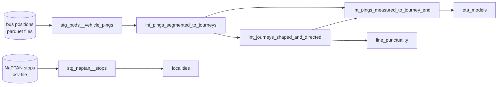

# Stop 3: ref(), and how models find each other

In the last stop you wrote `{{ ref('localities') }}` and it just worked. This is
the most important idea in dbt, so let us look under the bonnet.

## What ref() does

```sql
from {{ ref('localities') }}
```

`ref('localities')` means "the model called `localities`". Two things happen:

1. dbt swaps it for the real table name.
2. dbt writes down that **your model depends on `localities`**.

Number 2 is the magic. Because every model says what it depends on, dbt can draw
the whole map and work out the order to build things in. You never write "run A
before B". You just `ref()` and dbt figures it out.

### See it with your own eyes

`dbt compile` shows the SQL after dbt has done its swapping, without running it:

```bash
dbt compile --select localities
```

Look for the `from` line. Where you wrote `{{ ref('stg_naptan__stops') }}`, dbt
now prints something like:

```sql
select * from "wraith_bus_ingestor_build"."main"."stg_naptan__stops"
```

The compiled files live in `target/compiled/`. Open one and compare it with the
original: it is the same query with the curly-bracket bits filled in.

## source(): where data enters

`ref()` is for models. For data that arrived from *outside* dbt there is
`source()`. Open `models/staging/naptan/stg_naptan__stops.sql`:

```sql
with source as (

    select * from {{ source('naptan', 'stops') }}

),
```

and `models/staging/naptan/_naptan__sources.yml` says where `naptan.stops` lives:

```yaml
sources:
  - name: naptan
    tables:
      - name: stops
        meta:
          external_location: "read_csv('data/naptan_stops.csv', header=true, all_varchar=true, sample_size=-1)"
```

DuckDB can read a CSV or a Parquet file straight off the disk, so this project
never loads its raw data into a table first. The "source" is literally a file in
`data/`. The bus positions work the same way, from `.parquet` files.

## The family tree

This project has 8 models. Here is the whole map (dbt calls it the **DAG**, a
"directed acyclic graph", which just means arrows that never loop back):



The folder names tell you the layer, and this is a very common way to organise a
dbt project:

| Folder / prefix | Job |
|---|---|
| `staging/` (`stg_`) | Clean up raw data: rename and cast. One model per source. |
| `intermediate/` (`int_`) | The hard thinking: cutting pings into journeys, and so on. |
| `marts/` | The finished tables the app actually reads. |

## Running a slice of the map

`--select` gets really powerful with a `+`. Try each of these. `dbt ls` only
*lists*; it does not run anything, so it is a safe way to check what you are
about to run. (`--resource-type model` hides the tests, which would otherwise
flood the list.)

```bash
dbt ls --resource-type model --select eta_models                # just that one
dbt ls --resource-type model --select +eta_models               # it AND everything it depends on (upstream)
dbt ls --resource-type model --select stg_bods__vehicle_pings+  # it AND everything built from it (downstream)
```

Now the same idea with a real run: "rebuild `big_localities` and everything it
needs first":

```bash
dbt run --select +big_localities
```

!!! tip "The `+` is an arrow"
    `+model` reaches back to what the model *needs*. `model+` reaches forward to
    what *needs it*. Before you change something, run `model+` to see what you
    might break.

## Tinker

1. Run `dbt ls --resource-type model --select localities+`. It lists `localities` and `big_localities`.
   Why does it include `big_localities`?
2. **Break the arrows.** In `big_localities.sql` change `ref('localities')` to
   `ref('localitiez')` and run it.

??? question "What happened with the bad `ref`?"
    dbt refuses before it runs any SQL:

    ```text
    Compilation Error
      Model 'model.wraith_bus_ingestor.big_localities' depends on a node named
      'localitiez' which was not found
    ```

    This is a big benefit: a broken dependency is caught up front, not halfway
    through a two-hour build. Put the spelling back.

??? question "Why doesn't `stg_bods__vehicle_pings` have any arrows *into* it from other models?"
    Because its input is a **source** (files on disk), not another model. Sources
    are where the map starts.

!!! tip "Opinion"
    - **Always `ref()` and `source()`. Never type a table name.** A hard-coded name
      is invisible to dbt: it won't be ordered, tested or shown on the map.
    - Data flows forward only: staging, then intermediate, then marts. A mart never
      feeds staging.
    - Run `model+` **before** you change a model. Know what you can break.

Next: [Stop 4, Tests](4-tests.md).
