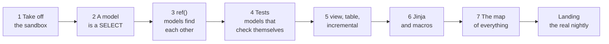

# Learn dbt: a magic carpet ride over Bus-land

You know SQL. You can use a terminal. That is everything you need.

This is a short trip, seven stops, and every stop uses the **real project in this
repo**: the one that watches thousands of UK buses live and works out whether
they are running late. Nothing here is a made-up toy. By the end you will have
read real models, run them, broken them on purpose, and understood why the
nightly build works the way it does.

## What is dbt, in one breath?

You already write `SELECT` statements. **dbt** lets you save each one in its own
file, and then:

- turns each file into a **table** (or view) in your database,
- works out **which files need which other files** and runs them in the right
  order,
- runs **tests** to check your answers make sense,
- and writes the **documentation** for you.

That is the whole idea. Everything else is detail. dbt does not move data around
and it does not have its own query language. It is a very clever kitchen manager
for SQL.

## The route

| Stop | You will learn | Time |
|---|---|---|
| [1. Take off](1-take-off.md) | Build a safe, synthetic sandbox and run dbt for the first time | 10 min |
| [2. A model is a SELECT](2-a-model-is-a-select.md) | Read, run and write a model | 15 min |
| [3. ref(): models find each other](3-ref-and-the-graph.md) | Dependencies, and how to run just a slice | 15 min |
| [4. Tests](4-tests.md) | Make dbt catch your mistakes | 15 min |
| [5. view, table, incremental](5-materializations.md) | Why a build went from an hour to a few minutes | 15 min |
| [6. Jinja and macros](6-jinja-and-macros.md) | Reusable SQL | 15 min |
| [7. The map of everything](7-docs-and-lineage.md) | Generate the project's documentation site | 5 min |
| [Landing](landing.md) | How the real nightly build uses all of it | 10 min |
| [The Rules](the-rules.md) | 22 blunt rules for how we do dbt here. Read them when you're done. | 10 min |
| [Cheat sheet](cheatsheet.md) | Every command and word in one place | |

## Two rules of the road

!!! danger "Never run `dbt` inside the repo's `dbt/` folder"
    That folder belongs to the **03:00 nightly build**. It has its own warehouse
    file, and if you run dbt there you can make tonight's build fail. Stop 1
    gives you a **sandbox**: a private copy with its own small, made-up data.
    Everything in this course happens there, and you cannot hurt anything.

!!! tip "Break things"
    Several stops tell you to break something on purpose. That is the fastest way
    to learn what the error messages mean. The sandbox is designed to be thrown
    away: one command rebuilds it from scratch.

## What you need

- A terminal on the machine that hosts this repo, and the repo checked out.
- The project's Python environment (`uv sync` has been run in the repo).

That's it. The sandbox's data is synthetic, generated fresh by a script
committed in the repo -- it does not need the nightly build to have ever run,
or any real bus data to exist anywhere.

Ready? Climb on: [Stop 1, Take off](1-take-off.md).
